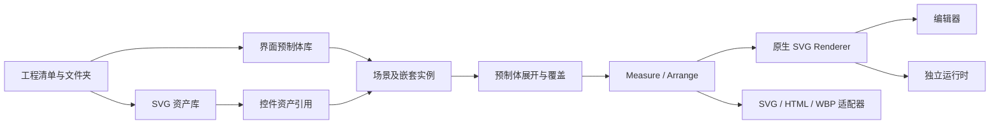

# SVG UI 系统架构

设计目标是维护一套可扩展的 SVG UI 系统。编辑器只是这套系统的制作工具，运行时和导出适配器都消费相同的模型、预制体展开结果和布局结果。

RuleStudio 完整 HUD 是该模型的一个消费方：`presentation` 声明预览控制器及示例数据；节点的 `binding` 定义显示角色，`action` 是白名单控制器解释的数据。预制体展开时独立复制动作对象，实例覆盖可替换动作参数。`BattleHudState` 管理当前槽、装配目标和四槽配置，`BattleHudController` 将它们投影到 SVG；通用布局与渲染器不依赖战斗引擎。

编辑器预览与独立页面使用同一个 `UIRuntime`。批量更新先验证所有节点，统一应用后重排一次；退出预览销毁监听器，恢复源场景，不保存运行时状态。完整 HUD 的组件清单与选中规则见 `Screen/RuleStudio-HUD/控件文档.md`。

运行时的 `setChildren(panelId, nodes)` 支持用现有预制体构造数据列表：先校验引用和 ID 冲突，再在派生视图内展开。替换列表会清除旧条目的运行时补丁与交互态，避免同一序号的新条目继承旧内容。装配列表按可用技能集合生成，条目通过实例覆盖绑定图标和动作；支持动态增减及滚动，没有固定三行的数量限制。

## 分层与数据流



| 层 | 入口 | 职责 |
| --- | --- | --- |
| 工程模型 | `src/core/model.js` | 节点类型、Slot、数据约束、引用与循环校验 |
| 文件夹 | `src/core/folders.js` | SVG / 预制体分类树、路径、合法移动、空目录删除 |
| 预制体 | `src/core/prefabs.js` | 稳定实例路径、嵌套展开、覆盖、应用、解除关联 |
| 布局 | `src/core/layout.js` | DesiredSize、Canvas 锚点、面板布局、世界矩形、逆向 Slot |
| SVG 资产 | `src/assets/svg.js` | 安全解析、基础样式归一、引用作用域、九宫格绘制 |
| 渲染 | `src/render/svg-renderer.js` | SVG defs 与 use、稳定节点复用、文字测量与状态绘制 |
| 运行时 | `src/runtime/runtime.js` | 输入状态机、activate 事件、局部运行时数据、生命周期 |
| 编辑器 | `src/editor/` | 检查器、资源库、隔离编辑、选择、拖动、事务历史 |
| 导入导出 | `src/io/` | HTML / Frame / WBP 适配，文件下载及本地 API 客户端 |
| 文件仓库 | `server/project-repository.mjs` | SVG / 预制体独立文件、内容复用、不可变修订、原子指针 |

## 资产、预制体与实例的所有权

**SvgAsset** 保存 SVG 原文、viewBox、缩放方式、九宫格和 folderId。控件通过资产 ID 引用。移动和改名只影响分类，SVG 的修改会更新全部引用者。文字、交互区域和布局不烘焙进按钮 SVG。

**PrefabAsset** 保存一个控件树根及其设计尺寸。它可代表一个按钮、一张卡片或整个界面，并能包含 `PrefabInstance`。源节点 ID 在编辑过程中保持稳定。

**PrefabInstance** 保存 prefabId、自身 Slot 和 overrides。源数据中没有展开后的副本。展开属于派生数据，渲染结束也不写回源模板。

**Scene** 是当前工程的主界面根。一个工程当前有一个主场景和任意数量的界面预制体。可以将整个主界面保存为预制体，嵌套到其他界面。

**Folder** 是独立的组织节点，具有 ID、kind、parentId。SVG 与预制体各自有分类树，支持多级目录。文件夹路径不承担资源身份；磁盘内容存储也不依赖可变的人类名称。

## 嵌套与覆盖规则

1. 源树保留模板 nodeId。实例展开 ID 采用 `instanceId::templateNodeId`，嵌套实例继续增加作用域。
2. 覆盖键采用模板路径 `rootId/childId/nestedInstanceId/nestedTemplateId`；改名不使覆盖失效。
3. 可以覆盖文字、样式、布局、Slot、SVG 引用、按钮状态和可见性。覆盖不允许更改身份、源层级或 prefabId。
4. 覆盖只影响一个实例。应用回模板时，普通子节点写入该模板；跨越嵌套边界的覆盖写入模板内的嵌套实例，不改动最深层共享预制体。
5. 解除关联保留最终有效值，并为展开后的子节点分配新 ID。
6. 校验器拒绝丢失引用和预制体依赖环；运行时也有循环和 20000 展开节点上限。

## WBP 布局语义

Canvas 的每个轴独立判断是否拉伸。

固定轴：

```text
size = AutoSize ? DesiredSize : OffsetSize
position = ParentSize × Anchor + OffsetPosition − size × Alignment
```

拉伸轴：

```text
size = ParentSize × (MaxAnchor − MinAnchor) − LeadingMargin − TrailingMargin
position = ParentSize × MinAnchor + LeadingMargin
```

因此右 / 下偏移在拉伸轴是边距，在固定轴是宽 / 高。拖动、缩放和切换锚点预设都使用同一套逆函数 `slotForRect`，避免重复定义。

面板先 Measure 子控件，再 Arrange。HorizontalBox / VerticalBox 扣除 Padding、Gap 和 Auto 尺寸，将剩余空间按 Fill 权重分配。Overlay 支持槽位对齐；SizeBox 覆盖期望尺寸；ScaleBox 维护层级缩放；ScrollBox 保留滚动偏移并裁剪。

布局和 SVG 渲染分离，后续 UE 适配器直接消费布局与 Slot，不必再从 DOM 反推 WBP。

## SVG 渲染与性能

- 以原生 SVG 元素绘制，不使用 foreignObject、不将整页栅格化。
- 每个资产在渲染器 defs 中只定义一次，控件通过 use 复用。每个渲染器拥有独立 ID 作用域，资产预览与场景不会互相串资源。
- 九宫格使用九个独立 viewBox；边角固定，中间延展。目标小于边角总和时按同一比例收缩边角。
- 按 ID 保留 SVG 分组；按钮状态仅切换绘制引用，保持节点与布局矩形。
- 资产使用变化标记参与绘制缓存，不为每个实例重复序列化 SVG 源码。
- 没有轮询或持续 requestAnimationFrame。布局、属性及输入事件触发更新；拖动事件仅合并到一次待执行绘制。
- 运行时悬停与按下不重新展开预制体或计算布局。编辑器的交互预览遵守相同原则。
- 撤销以用户事务为单位，拖动手势只存一条记录，保留最近 80 条。

## 运行时接口

```js
import { UIRuntime } from './src/runtime/runtime.js';
const runtime = new UIRuntime(svgElement, project, {
  prefabId: 'optional-interface-prefab',
  width: 1920,
  height: 1080,
});
runtime.addEventListener('activate', ({ detail }) => {
  console.log(detail.id, detail.node.name);
});
runtime.setText(stableScopedId, '新的文字');
runtime.setValue(progressScopedId, 0.8);
runtime.render(newWidth, newHeight);
runtime.destroy();
```

运行时补丁和按钮状态保存在运行时实例中，不修改工程与预制体源数据。业务层订阅事件并显式更新数据；UI 内核不加载游戏账号、背包、技能等模块。

## 动效资产与引擎播放

动效由 `document.motions` 统一管理，节点与预制体实例通过稳定资产 ID 引用。每个资产含事件映射和具名片段，片段含时长、循环、缓动与六通道关键帧。SVG 负责静态外观，时间轴负责视觉变化，Slot 负责布局。编辑器的动效资产库与检查器只是这份数据的编辑入口。

网页与 UE 消费同一份版本化定义：网页生成 WAAPI 时间轴，UE 导入共享 `SvgCanvasMotionAsset` 并由通用 `SvgCanvasMotionNode` 执行。新增效果只新增数据，播放器不识别 HUD 名称或控件 ID。静态 PNG 无需为新的位移、缩放、旋转或透明度动画重新烘焙。详见 [动效契约](MOTION.md)。

## 后续扩展约定

战斗套件通过 `interfaceCatalog` 注册多个独立界面：目录引用现有预制体，不复制控件树。编辑器切换模板隔离编辑，运行时仅挂载当前窗口；切换预览界面共享临时状态，源工程保持不变。视觉资产、模板、预览数据和视图投影分别在 `suite-art`、`suite-pages`、`suite-data` 与 `runtime/battle-suite` 中维护。文本输入只在编辑期间创建临时输入元素，最终文本仍由 SVG 绘制。

- 新通用控件：在模型注册类型，再分别补布局、SVG 绘制和运行时行为；检查器只是属性视图。
- 新主题：新增 SVG 资产和预制体，或修改实例资产引用，不复制业务运行模块。
- 新布局：增加纯布局策略及逆向编辑约定，用几何断言覆盖固定、拉伸、嵌套及非 16:9 情况。
- 新引擎：实现独立导出适配器，消费有效树、原始 Slot、资产和状态契约；不把编辑器业务写进引擎接口。
- 更复杂需求可在当前模型上增加预制体变体、材质动画轨道、多场景工程、组件绑定和资产热更新；这些能力当前未宣称已实现。

## 当前边界

HTML 导入保留当前测量结果和可编辑层级，复杂 CSS、外部资源、变换与阴影会报告缺口。对任意 HTML 的像素一致重建未作承诺。UE 插件支持当前 SVG 画布的逐控件 PNG、原始 Slot、状态与通用动效资产导入；UE 动态材质、任意 CSS 动画、原生字体差异、ListView 虚拟化和业务绑定仍需专门适配。


### 原生 WBP 的弹窗布局

逐控件 PNG 是绘制缓存，不能代替布局规则。导出状态携带 `layoutScale`（缓存中已烘焙的累计缩放），并从源 `computeLayout` 冻结每个界面在多种屏幕尺寸下的期望几何。UE `USvgCanvasNode` 的 ScaleBox 使用原生 Slate 布局缩放，按当前分配尺寸和源 padding / slot alignment / stretch 安排整个子树，自动随视口变化；图片、裁剪和输入共用该变换。其他覆盖式面板使用对应的原生填充 / 对齐槽位。覆盖节点全尺寸的背景缓存使用拉伸边距，遮罩因此覆盖实际屏幕。

自适应验证逐个比对源布局与真实 Slate 安排结果，并对按钮输入矩形、屏幕遮罩、保存后重载和手工 WBP 覆盖做检查。布局与零容差像素验收分别记录；原生截图不会套用网页覆盖图。
